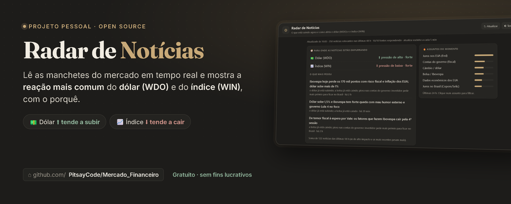
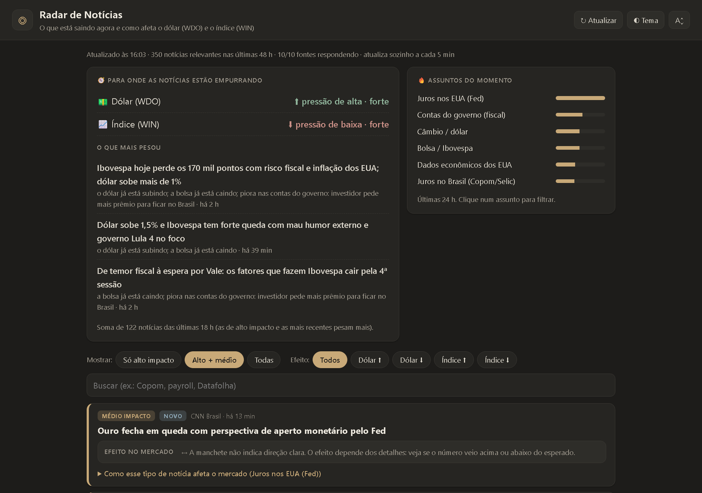
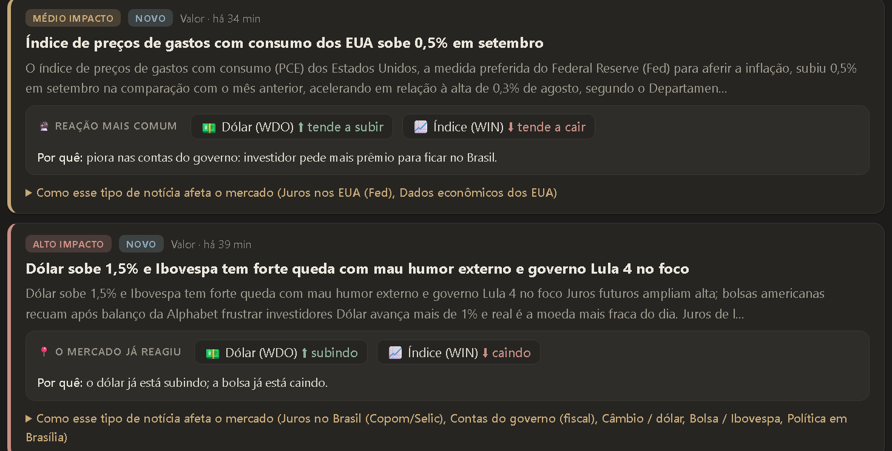
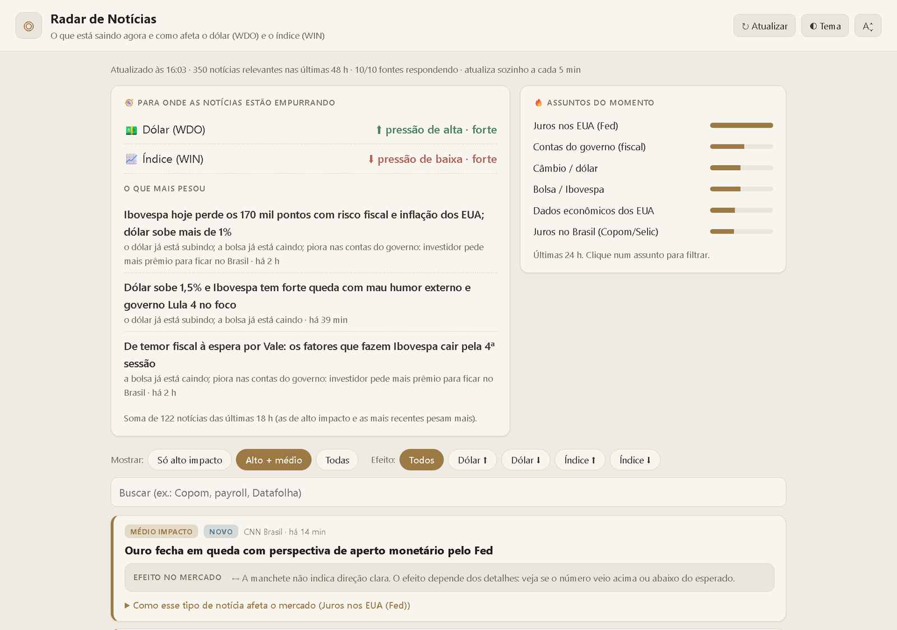
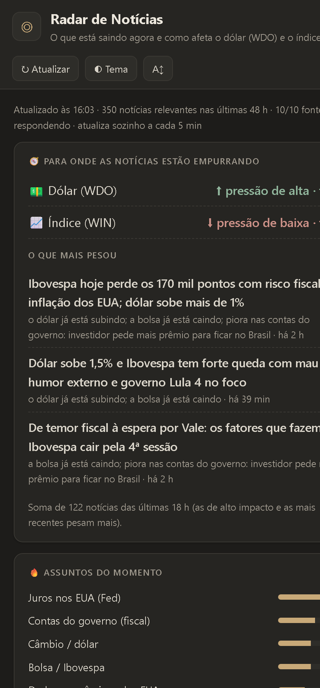

<p align="center">
  
</p>

<h1 align="center">◎ Radar de Notícias</h1>

<p align="center">
  <b>O que está saindo agora no mercado — e como isso costuma mexer no mini dólar (WDO) e no mini índice (WIN).</b>
</p>

<p align="center">
  
  
  
  
</p>

<p align="center">
  <a href="#-como-usar">Como usar</a> ·
  <a href="#-o-que-ele-faz">O que ele faz</a> ·
  <a href="#-como-funciona">Como funciona</a> ·
  <a href="#-telas">Telas</a> ·
  <a href="#%EF%B8%8F-aviso-importante">Aviso</a>
</p>

---

## 💡 A ideia

Quem opera day trade em **WIN** e **WDO** passa o dia pulando entre portais de notícia tentando responder uma pergunta só:

> *"Essa manchete empurra o dólar e a bolsa para qual lado?"*

O **Radar de Notícias** junta as manchetes das principais fontes do mercado brasileiro em uma tela só, separa o que importa do que é ruído e mostra, para cada notícia, a **reação mais comum** do dólar e do índice — sempre explicando **o porquê**.

É um mini projeto pessoal, feito para estudo e uso próprio. Sem anúncio, sem cadastro, sem cobrança.

## ✨ O que ele faz

| | |
|---|---|
| 📰 **Junta as notícias** | Lê 10 feeds públicos: InfoMoney, Valor, Money Times, Investing e buscas temáticas no Google Notícias (Copom, Fed, fiscal, eleições…). |
| 🎯 **Classifica o impacto** | Cada manchete recebe *alto*, *médio* ou *baixo* impacto conforme o assunto: juros nos EUA, Copom/Selic, inflação, fiscal, eleição, câmbio, commodities, geopolítica… |
| 🧭 **Indica a direção** | Mostra se o dólar (WDO) e o índice (WIN) **tendem a subir ou cair** com aquele tipo de notícia — ou se o mercado **já reagiu** (“dólar sobe 1,5%”). |
| 📖 **Explica o motivo** | Cada efeito vem com o raciocínio econômico por trás, em linguagem simples. Ótimo para aprender. |
| 📊 **Resumo do momento** | Um painel soma as notícias das últimas horas e mostra para onde o noticiário está *empurrando* cada ativo, além dos assuntos mais quentes. |
| 🔎 **Filtros e busca** | Filtre por impacto, por efeito (Dólar ⬆, Índice ⬇…) ou busque por palavra (ex.: *payroll*, *Datafolha*). |
| 🌗 **Confortável de ler** | Tema escuro *grafite* e claro *papel*, três tamanhos de letra e atualização automática a cada 5 minutos. |

## 🚀 Como usar

**Pré-requisito:** apenas o [Python 3](https://www.python.org/downloads/). Não precisa instalar nenhuma biblioteca.

```bash
git clone https://github.com/PitsayCode/Mercado_Financeiro.git
cd Mercado_Financeiro
python app.py
```

O navegador abre sozinho em **http://127.0.0.1:8765**. Deixe a janela do terminal aberta enquanto usa; para fechar, `Ctrl+C`.

> 🪟 **No Windows** é ainda mais fácil: dê dois cliques em **`Iniciar.bat`**.

**Opções:**

| Parâmetro | O que faz |
|---|---|
| `--porta=8800` | Usa outra porta (padrão: `8765`) |
| `--sem-navegador` | Inicia o servidor sem abrir o navegador |

## ⚙️ Como funciona

```
 Feeds RSS ──► app.py ─────────────────────────────► navegador (web/)
 (10 fontes)   │ 1. baixa os feeds em paralelo        │ painel de pressão
               │ 2. remove duplicadas e notícias +48h │ assuntos do momento
               │ 3. pontua o impacto (regras)         │ cartões com efeito
               │ 4. lê a direção da manchete          │ filtros e busca
               └─ /api/noticias (cache de 5 min) ─────┘
```

- **Impacto:** cada assunto tem palavras-chave e um peso. Palavra no título vale o dobro da que aparece só no resumo. A soma define *alto*, *médio* ou *baixo*.
- **Direção:** regras de economia reconhecem padrões como *“payroll acima do esperado”*, *“Copom corta a Selic”* ou *“temor fiscal”* e aplicam a reação típica de WDO e WIN. Quando a manchete já relata o movimento (*“Ibovespa cai”*), isso tem prioridade.
- **Tudo local:** um servidor HTTP da própria biblioteca padrão do Python serve a interface (HTML + CSS + JavaScript puros) e a API. Nenhum dado seu sai do seu computador.

### Estrutura

```
├── app.py          # servidor, coleta dos feeds e regras de classificação
├── Iniciar.bat     # atalho para Windows
└── web/
    ├── index.html  # interface
    ├── style.css   # temas grafite/papel
    └── app.js      # painel, cartões, filtros
```

## 🖼️ Telas

<p align="center">
  
  <br><sub>Painel “para onde as notícias estão empurrando” e assuntos do momento</sub>
</p>

<p align="center">
  
  <br><sub>Cada notícia mostra o impacto, a reação mais comum e o porquê</sub>
</p>

<table>
  <tr>
    <td width="68%"><br><sub align="center">Tema claro “papel”</sub></td>
    <td width="32%"><br><sub>Também funciona em telas estreitas</sub></td>
  </tr>
</table>

## 🛠️ Personalizando

Quer acompanhar outro assunto ou ajustar os pesos? Está tudo em `app.py`:

- **`FEEDS`** — adicione ou remova fontes RSS (a função `google_news("sua busca")` cria um feed a partir de qualquer pesquisa).
- **`REGRAS`** — temas, palavras-chave, peso e o texto explicativo de cada um.
- **`DIRECAO`** — padrões de manchete e o empurrão que dão no WDO e no WIN.
- **`CACHE_SEGUNDOS`** e **`HORAS_MAXIMAS`** — frequência de atualização e idade máxima das notícias.

## ⚠️ Aviso importante

O efeito exibido é a **reação mais comum** do mercado a cada tipo de notícia, calculada por regras simples de economia. **Não é previsão, nem recomendação de compra ou venda.** O que move o preço é a *surpresa* em relação ao esperado — confira sempre no gráfico e faça sua própria análise.

As notícias pertencem aos seus respectivos veículos; o app apenas lê os feeds públicos e leva você ao link original.

## 🤝 Contribuições

Projeto pessoal e sem fins lucrativos, mas sugestões são bem-vindas! Abra uma *issue* com ideias de novas regras, fontes ou melhorias na interface.

---

<p align="center">
  Feito com ☕ e muitas manchetes por <a href="https://github.com/PitsayCode">PitsayCode</a>
</p>
